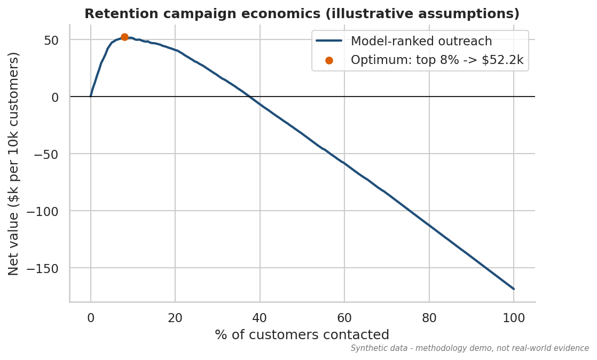
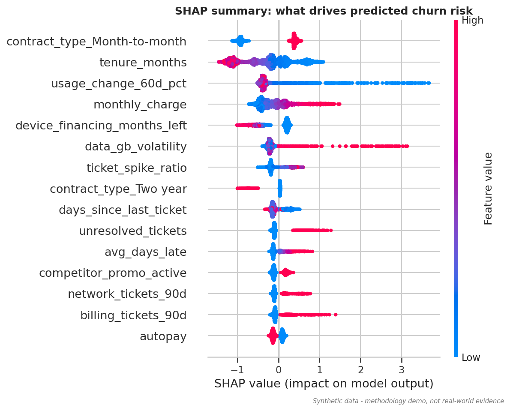

# Customer Churn Prediction & Retention (Telecom)

> ## ⚠️ All data is synthetic
> Every dataset in this repository was generated by [`src/generate_data.py`](src/generate_data.py) from assumptions chosen by the author for a
> fictional carrier ("Synthetic Telecom Co."). **Findings demonstrate methodology, not real-world evidence**, and the model metrics are *not* industry benchmarks.

**Part 1 of a 5-project telecom analytics portfolio.** Skills shown: SQL feature engineering, data cleaning, EDA with statistical testing,
class-imbalance handling, model comparison (Logistic Regression, Random Forest, XGBoost), SHAP explainability, probability calibration,
and a decision-focused cost model with an A/B test design.

## 1. Business problem
In this synthetic scenario, about 8% of a carrier's subscribers cancel within a given 30-day window. Retention offers cost money, and offering them to customers
who would have stayed anyway burns margin. **Which customers will cancel in the next 30 days, which of them are worth contacting, and how many should we contact?**

**Objectives**
1. Rank subscribers by 30-day churn risk using billing, contract, usage and support-ticket data.
2. Show whether class-imbalance techniques (class weights, SMOTE) actually help at an 8% base rate.
3. Explain the drivers so retention teams can choose the right action.
4. Convert scores into a campaign size and expected net value, and design an experiment to validate the assumptions.

## 2. Headline results (synthetic data, seed 42, 10,000-customer hold-out)
| Model (best strategy) | ROC-AUC | PR-AUC | Recall @ top 10% | Precision @ top 10% | Lift @ top 10% |
|---|---|---|---|---|---|
| Logistic Regression | 0.906 | 0.654 | 64.5% | 51.1% | 6.5x |
| Random Forest | 0.912 | 0.671 | 65.8% | 52.1% | 6.6x |
| **XGBoost (champion)** | **0.918** | **0.690** | **66.9%** | **53.0%** | **6.7x** |

Base rate 7.9% (PR-AUC of a no-skill model = 0.079). Model selection used 3-fold CV on the training set; the hold-out was used once.

| Retention campaign (illustrative assumptions) | Result |
|---|---|
| Optimal outreach size | Top **8%** of customers (804 of 10,000) |
| Churners reached / list precision | 497 of 792 (**62%** precision) |
| Expected net value | **≈ $52k per 10k customers scored** |
| Same budget, random targeting | **−$13.5k** (loses money: 8% precision is below the ~33% break-even) |
| Value-aware rule (contact if p × save-rate × value > cost) | 9% of customers, ≈ $54k |
| Pessimistic corner (15% save rate, $50/contact) | still ≈ +$6k, but list shrinks to ~4% |

Assumptions: $3 contact + $25 offer cost per contact; 30% of contacted churners accept and stay; saved customer worth monthly charge × 12 × 40% margin.
See [`src/config.py`](src/config.py) to change them.



## 3. Key findings and what to do about them
| Finding (synthetic data) | Evidence | Recommended action |
|---|---|---|
| Contract type is the largest structural driver | Churn: month-to-month **13.1%**, one-year 2.3%, two-year 0.7% (Cramér's V = 0.21) | Offer discounted 12-month contracts to month-to-month customers *before* they show risk signals |
| The first six months are the danger zone | Churn **20%** at 0-6 months vs 1.3% at 49+ months | Build an onboarding / first-bill check-in programme |
| Falling data usage is an early warning | Usage down >20% → **29%** churn (3.7x base) in 14% of the base | Trigger plan right-sizing or engagement offers when usage drops |
| Ticket bursts precede cancellation | 2+ tickets in 30 days → ~**23%** churn vs 4.6% with none | Proactive service callback *before* any discount; fix unresolved tickets |
| Higher bills and late payments raise risk | Median charge $85 (churners) vs $64; risk rises with each late payment | Review pricing/bill-shock alerts; flexible payment dates |
| Contractual lock-in protects | SHAP: device financing and 2-year contracts lower risk | Use device-instalment offers as a retention lever |
| ~22% of churners show *no* usage drop and *no* ticket | EDA | Rules alone miss them → keep the multivariate model |



### Honest methodological notes
- **SMOTE and class weights did not improve ranking performance** here. "No resampling" had the highest CV PR-AUC for all three algorithms
  (e.g. XGBoost 0.677 none vs 0.673 class-weight vs 0.674 SMOTE; Random Forest 0.653 vs 0.644 vs 0.627). With ~3,200 positive training cases, 8% prevalence is moderate. SMOTE was applied
  *inside* the CV pipeline (no leakage) but interpolates one-hot dummies into fractional values and made Random Forest ~2.6x slower. I report the null result rather than force a SMOTE win.
- **Gaps between models are modest** (XGBoost vs logistic: +3.6 PR-AUC points on hold-out), so a transparent logistic model is a credible fallback.
- **Synthetic data is easier than reality.** ROC-AUC ≈ 0.92 reflects planted signal; real churn models usually separate less cleanly. The *process* is what transfers.
- **Associational, not causal.** SHAP/odds ratios describe what the model uses. The 30% save rate is an assumption; the A/B design in notebook 03 is how it would be measured.
- Logistic odds ratios in `reports/logistic_odds_ratios.csv` are for standardised numeric features; one-hot categories are not individually interpretable (no reference level) and some features are collinear.

## 4. Repository structure
```
├── README.md                 ← you are here
├── Makefile                  ← `make all` reproduces everything
├── requirements.txt  ruff.toml  LICENSE  .gitignore  .github/workflows/ci.yml
├── data/
│   ├── raw/                  ← generated CSVs (git-ignored; `make data`)
│   ├── processed/            ← model_table.csv, telecom.db (git-ignored)
│   └── sample/               ← 1,000-customer samples committed for quick inspection
├── src/
│   ├── config.py             ← seeds, paths, business assumptions
│   ├── generate_data.py      ← synthetic data generator (documented planted effects)
│   ├── clean.py              ← cleaning rules + reports/cleaning_report.json
│   ├── features.py           ← feature engineering (point-in-time, no leakage)
│   ├── eda.py  models.py  metrics.py  train.py  evaluate.py  business.py  plotting.py
│   ├── build_sqlite.py       ← loads SQLite, runs SQL
│   └── run_notebooks.py      ← builds + executes the notebooks
├── sql/                      ← 01_schema, 02_feature_extraction, 03_analysis_queries
├── notebooks/                ← 01_eda, 02_modeling, 03_evaluation_and_business_case (outputs embedded)
├── app/streamlit_app.py      ← interactive risk-scoring demo
├── tests/test_pipeline.py    ← reproducibility, cleaning, leakage, SQL↔pandas parity
├── reports/                  ← figures/, metrics.json, cv_results.csv, sensitivity.csv, shap_importance.csv ...
└── docs/data_dictionary.md
```

## 5. How to run
```bash
python -m venv .venv && source .venv/bin/activate      # Windows: .venv\Scripts\activate
pip install -r requirements.txt
make all            # generate data -> clean -> features -> EDA -> train -> evaluate -> SQL -> notebooks (~5-8 min on 1 CPU)
make test           # 6 tests
streamlit run app/streamlit_app.py
```
Without `make`: `python -m src.generate_data && python -m src.clean && python -m src.features && python -m src.eda && python -m src.train && python -m src.evaluate`.
Everything is seeded (`SEED = 42`), so results reproduce exactly on the same library versions.
Quick CI-sized run: `python -m src.generate_data --n-customers 3000 --out /tmp/raw`.

## 6. Methodology
1. **Synthetic generation** - a logistic data-generating process over observable and latent attributes, intercept calibrated by bisection to ≈ 8% churn;
   behaviour (usage, tickets) is generated *after* the churn draw to mimic leading indicators; decoys and 45-50% "silent churners" prevent trivial separation.
2. **Cleaning** - de-duplicate, normalise categories, null impossible ages, recover missing charges from billing, flag unknown payment method. All counts logged.
3. **Features** - 6-month billing aggregates, ticket windows (30/90/180 days), 60-day usage trend, derived ratios. Labels and `churn_date` live in a separate table.
4. **Validation** - 80/20 stratified hold-out; 3-fold stratified CV; imputation/scaling/SMOTE all fitted inside the pipeline on training folds only.
5. **Metrics** - PR-AUC (primary), ROC-AUC, recall/precision/lift at top 5%/10%; calibration curve and Brier score for the champion.
6. **Explainability** - SHAP TreeExplainer on 3,000 hold-out customers; logistic odds ratios.
7. **Decision layer** - net-value curve over contact fraction, value-aware per-customer rule, sensitivity grid, A/B sample-size calculation.

## 7. SQL
`sql/02_feature_extraction.sql` rebuilds the billing and ticket features in pure SQL (CTEs, conditional aggregation, point-in-time windows), and
`tests/test_pipeline.py` asserts that SQL and pandas produce identical values. `sql/03_analysis_queries.sql` includes business queries with revenue exposure and a `RANK() OVER (PARTITION BY ...)` window function.

## 8. Limitations and next steps
- Single snapshot: no time-based validation or drift analysis (next: rolling snapshots + PSI monitoring).
- Hyper-parameters are sensible defaults, not tuned (next: Optuna + monotonic constraints).
- Offer response is assumed, not modelled (next: uplift modelling; see Project 5).
- Power BI is not used in this project (planned for Projects 3 and 5).

## 9. License and disclaimer
MIT (see `LICENSE`). Synthetic data only; no real customer information was used. Not affiliated with any telecom operator.

## 10. Author: Abdullahi M. Cadceed
@cxdceed on LinkedIn
